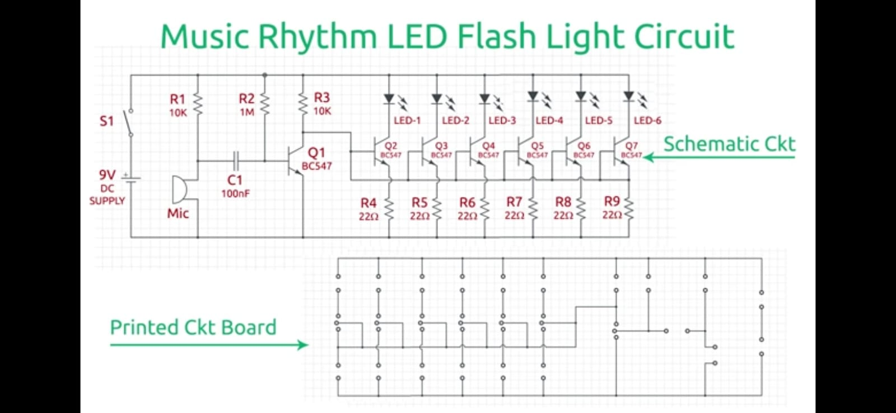
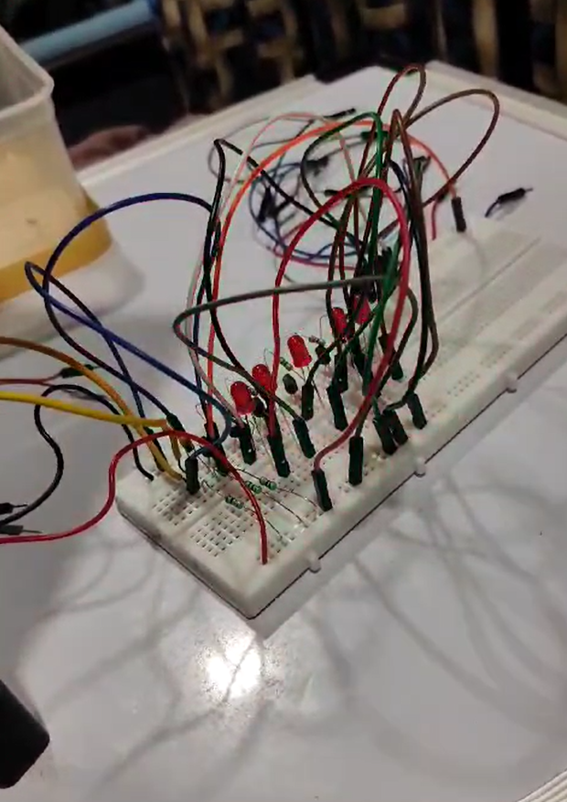

# Digital Clap-Controlled LED

A sound-responsive LED circuit that detects claps and music through a microphone and produces real-time LED flashing using transistor-based switching.

## Overview

This project demonstrates a hardware-based sound-responsive lighting system. A microphone detects sound signals, and the circuit responds by switching multiple LEDs. When music is played nearby, the LEDs flash in response to the audio, creating a rhythm-based lighting effect.

The project explores microphone-based sound detection, transistor switching, and electronic circuit design without requiring a microcontroller.

## Objectives

- Detect claps and surrounding audio using a microphone.
- Use sound signals to control multiple LEDs.
- Demonstrate transistor-based switching and electronic circuit design.
- Create a real-time LED flashing effect in response to music and sound.

## Components Used

- BC547 NPN transistors
- Microphone
- Six LEDs
- Resistors
- 100 nF capacitor
- 9V DC power supply
- Switch and connecting wires

## Working Principle

1. **Sound Detection:** The microphone converts incoming sound waves into an electrical signal.
2. **Signal Processing:** The circuit uses transistor stages and passive components to respond to the detected audio signal.
3. **LED Switching:** The transistor stages control the LEDs based on the circuit's response to sound.
4. **Music-Responsive Lighting:** Music and claps produce sound signals that cause the LEDs to flash, creating a sound-responsive lighting effect.

## Circuit Diagram

## Hardware Prototype

## Demonstration Video

Watch the LEDs respond to music and sound in the demonstration video uploaded to this repository.

**Video:** [LED Demonstration](./Project_Demonstration.mp4)

> If your uploaded video has a different filename or extension, update the link above to match the exact filename displayed in your repository.

## Applications

- Sound-responsive decorative lighting
- Music-synchronized LED effects
- Basic sound detection demonstrations
- Electronics and transistor-switching experiments

## Concepts Demonstrated

- Analog electronics
- Microphone-based sound detection
- BC547 transistor switching
- Electronic circuit design
- Sound-responsive LED control

## Future Improvements

- Adjustable sound sensitivity
- Improved response to different sound frequencies
- More precise sound-level detection
- Programmable LED patterns using a microcontroller

## Author

Taksh Kalathia

## License

This project is licensed under the MIT License.
